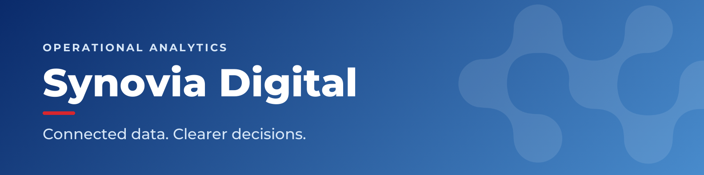

  

## Get decisions out of your data

Synovia Digital brings operational data together, improves reporting clarity and identifies practical, well-governed automation opportunities.

| | |
|---|---|
| **Connected data** | Operational data brought together instead of spread across systems. |
| **Clearer reporting** | Reports that support better business decisions. |
| **Governed automation** | Practical automation opportunities, built on trusted data. |
| **Visibility → action → improvement** | Analytics that leads to real operational progress. |

Analytics is part of a wider foundation that also covers SAP & ERP, supply chain integration and logistics products.

This organization holds Synovia Digital's production code.

---

  
   
  <a href="https://synoviadigital.com">synoviadigital.com</a> · <a href="https://synoviadigital.com/solutions/#analytics">Analytics</a>

